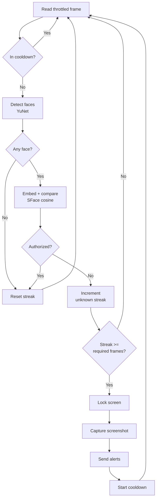

<p align="center">
  
</p>

<p align="center">
  <a href="https://www.python.org"></a>
  <a href="https://opencv.org"></a>
  <a href="https://textual.textualize.io"></a>
  <a href="https://docs.astral.sh/uv/"></a>
  <a href="https://docs.pytest.org"></a>
  
</p>

# Sentry

Face-based desktop intrusion detection with automated response. Sentry watches a webcam, learns the authorized user's face on first launch, and when it confirms an unrecognized face it locks the workstation, captures a screenshot, and sends alerts over email or WhatsApp. Enrollment and monitoring run in a single Textual terminal UI.

```bash
python -m src
```

## Overview

Sentry runs one unified terminal UI (`SentryApp`) that boots the camera and face models, enrolls the user if no face data exists, then transitions to continuous monitoring. Face detection uses OpenCV's YuNet DNN model; recognition uses OpenCV's SFace model, which produces 128-dimensional embeddings compared with cosine similarity. Enrolled embeddings are stored locally as a pickle file in `models/`.

To suppress single-frame false positives, an intrusion is only confirmed after a configurable number of consecutive frames contain an unauthorized face. Once confirmed, the response actions (lock, screenshot, alert) each run independently so a failure in one does not block the others, and a cooldown period follows before detection resumes.

## Features

Each item below maps to code in `src/`.

- Unified enrollment-then-monitoring flow in a single Textual TUI (`src/main.py`).
- Auto-enrollment on first launch: captures 10 face samples, then saves embeddings (`EnrollmentEngine`).
- Face detection via OpenCV YuNet and recognition via OpenCV SFace with 128-dim embeddings (`src/face_recognition.py`).
- Automatic one-time model download from Hugging Face when model files are missing.
- Multi-frame confirmation with a configurable `required_consecutive_frames` threshold (`MonitoringEngine`).
- Cross-platform screen lock: Windows (`LockWorkStation` via ctypes), macOS (`CGSession` / screensaver), Linux (`loginctl`, D-Bus, `xdg-screensaver`, GNOME, KDE) with safe fallback (`src/screen_lock.py`).
- Timestamped PNG evidence capture with `0600` permissions on Unix and retention-based cleanup (`src/screenshot.py`).
- Email alerts over SMTP (STARTTLS or SSL) with screenshot attachment, and WhatsApp Business Cloud API alerts with optional image upload (`src/notifier.py`).
- Rotating file log plus console log with structured security events (`src/logger.py`).
- Cooldown window after each confirmed intrusion before monitoring resumes.
- Keyboard-driven controls: pause/resume, re-enroll, screenshot cleanup, clear log, quit.

## Tech Stack

| Area | Technology |
| --- | --- |
| Language | Python 3.10+ |
| Face detection | OpenCV DNN, YuNet (`face_detection_yunet_2023mar.onnx`) |
| Face recognition | OpenCV DNN, SFace (`face_recognition_sface_2021dec.onnx`), 128-dim embeddings |
| Similarity | Cosine similarity via `cv2.FaceRecognizerSF` |
| Terminal UI | Textual |
| Imaging | NumPy, Pillow (`ImageGrab`) |
| HTTP | requests (model download, WhatsApp API) |
| Email | `smtplib` with `ssl` (STARTTLS / SSL) |
| Config | PyYAML, python-dotenv |
| Packaging / build | uv, hatchling |
| Testing | pytest, pytest-asyncio |

## Architecture

```mermaid
flowchart TD
    A[python -m src] --> B[SentryApp TUI]
    B --> C[Camera<br/>OpenCV VideoCapture]
    B --> D[FaceDetector<br/>YuNet ONNX]
    B --> E[FaceRecognizer<br/>SFace ONNX]
    B --> F[EnrolledFaceStore<br/>models/enrolled_face.pkl]

    B --> G{Face data<br/>enrolled?}
    G -- No --> H[EnrollmentEngine<br/>capture 10 samples]
    H --> F
    H --> I[MonitoringEngine]
    G -- Yes --> I

    I --> J[Screen lock<br/>src/screen_lock.py]
    I --> K[Screenshot<br/>src/screenshot.py]
    I --> L[Notifier<br/>Email / WhatsApp]
    I --> M[EventLogger<br/>logs/sentry.log]

    C -.config.yaml.-> N[Config loader]
    L -.env vars.-> O[.env]
    N --> I
```

## Monitoring Workflow



## Prerequisites

- Python 3.10 or newer
- A connected webcam
- [uv](https://docs.astral.sh/uv/) (recommended) or pip
- Outbound network access on first run to download the two ONNX models (roughly 0.25 MB and 37 MB) from Hugging Face

## Installation

Clone the repository:

```bash
git clone https://github.com/your-username/sentry.git
cd sentry
```

Install and run with uv:

```bash
uv sync --extra dev
uv run python -m src
```

Or with pip and a virtual environment:

```bash
python -m venv .venv
# Windows (PowerShell)
.venv\Scripts\Activate.ps1
# macOS / Linux
source .venv/bin/activate

pip install -e ".[dev]"
python -m src
```

On first launch Sentry downloads the face models into `models/`, opens the camera, guides you through enrollment, then transitions to monitoring automatically.

## Usage

```bash
python -m src            # Launch the TUI (enroll if needed, then monitor)
python -m src --cleanup  # Delete screenshots past the retention window, then exit
python -m src --help     # Print usage and exit
```

### Keyboard Shortcuts

| Key | Action |
| --- | --- |
| `Space` | Pause / resume monitoring |
| `R` | Re-enroll (clears stored face data) |
| `D` | Delete old screenshots |
| `L` | Clear the event log view |
| `Q` | Quit |

## Configuration

Runtime behavior is controlled by `config.yaml`. Values below are the shipped defaults.

```yaml
camera:
  device: 0                 # Webcam device index
  frame_interval_ms: 250    # Minimum interval between processed frames

detection:
  required_consecutive_frames: 5   # Unknown frames needed to confirm an intrusion
  recognition_threshold: 0.55      # Minimum cosine similarity to count as authorized

security:
  lock_on_unknown_face: true
  screenshot_on_unknown_face: true
  cooldown_seconds: 30             # Quiet period after a confirmed intrusion

storage:
  screenshot_directory: "./screenshots"
  log_directory: "./logs"
  model_directory: "./models"
  retention_days: 7                # Age at which screenshots are cleaned up

notifications:
  email: true       # Must also be enabled via EMAIL_ENABLED in .env
  whatsapp: false   # Must also be enabled via WHATSAPP_ENABLED in .env
```

A channel sends only when both its `config.yaml` flag and its `.env` enable flag are true.

## Environment Variables

Credentials live in `.env`. Copy the template and fill in values:

```bash
cp .env.example .env
```

| Variable | Default | Description |
| --- | --- | --- |
| `EMAIL_ENABLED` | `false` | Enable the email channel |
| `SMTP_HOST` | | SMTP server host |
| `SMTP_PORT` | `587` | SMTP port (`465` uses SSL, otherwise STARTTLS) |
| `SMTP_USERNAME` | | SMTP username and From address |
| `SMTP_PASSWORD` | | SMTP password or app password |
| `ALERT_EMAIL` | | Recipient address for alerts |
| `WHATSAPP_ENABLED` | `false` | Enable the WhatsApp channel |
| `WHATSAPP_API_URL` | | WhatsApp Cloud API messages endpoint |
| `WHATSAPP_API_TOKEN` | | Bearer token for the API |
| `WHATSAPP_DESTINATION` | | Recipient phone number |

Email requires `SMTP_HOST`, `SMTP_USERNAME`, `SMTP_PASSWORD`, and `ALERT_EMAIL`. WhatsApp requires `WHATSAPP_API_URL`, `WHATSAPP_API_TOKEN`, and `WHATSAPP_DESTINATION`. `.env` is git-ignored and must never be committed.

## Project Structure

```text
sentry/
├── config.yaml              # Runtime configuration
├── pyproject.toml           # Dependencies and build config
├── .env.example             # Notification credentials template
├── src/
│   ├── __main__.py          # CLI entry point (launch, --cleanup, --help)
│   ├── main.py              # Unified TUI: EnrollmentEngine + MonitoringEngine
│   ├── config.py            # YAML + .env config loader
│   ├── logger.py            # Rotating file and console logger
│   ├── camera.py            # OpenCV webcam abstraction
│   ├── face_recognition.py  # YuNet detector, SFace recognizer, face store
│   ├── screen_lock.py       # Cross-platform screen locking
│   ├── screenshot.py        # Timestamped capture + retention cleanup
│   └── notifier.py          # Email + WhatsApp alert routing
├── models/                  # ONNX models + enrolled_face.pkl (git-ignored)
├── screenshots/             # Captured evidence (git-ignored)
├── logs/                    # Event logs (git-ignored)
└── tests/                   # pytest suite
```

## Development

Run the test suite (62 tests):

```bash
uv run python -m pytest        # or: python -m pytest
uv run python -m pytest -v     # verbose
```

Tests cover camera handling (mocked), the face store, config loading, screen-lock dispatch, screenshot capture and retention, notification routing, and the monitoring state machine including multi-frame confirmation, cooldown, and intrusion response.

## Security and Privacy

- Face embeddings stay on disk in `models/enrolled_face.pkl` and are never transmitted.
- Credentials live only in `.env`, which is git-ignored.
- Screenshots are written with `0600` permissions on Unix systems.
- Screenshots older than `retention_days` are removed on cleanup.
- A notification failure never blocks screen lock or evidence capture.

Only run Sentry on devices and workspaces you are authorized to monitor, and comply with applicable privacy, biometric, and workplace-monitoring laws.

## Deployment

Sentry is a foreground TUI, so autostart it in an interactive desktop session where the camera and screen lock are available.

| Platform | Approach |
| --- | --- |
| Windows | Task Scheduler task running `python -m src` at logon |
| macOS | LaunchAgent in `~/Library/LaunchAgents/` running `python -m src` |
| Linux | systemd user service or an XDG autostart entry running `python -m src` |

Schedule periodic retention cleanup with `python -m src --cleanup`.

## License

Licensed under the MIT License, as declared in `pyproject.toml`.
